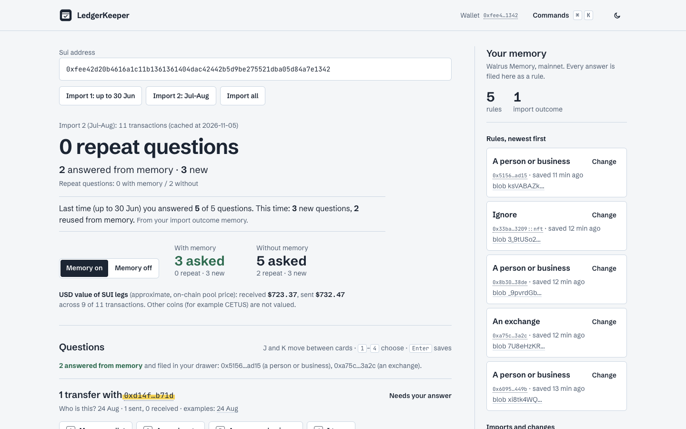

# LedgerKeeper

**Labelled Sui records for your accountant. You answer each unclear transaction once; your answers live in your own Walrus Memory and are reused on every later import and by any other app you allow.**

Live demo: https://ledgerkeeper.ajkadri.dev · Code: https://github.com/AjKadri/ledgerkeeper · Built for Total Recall (Consumer Finance Apps).

> Labelling for your accountant, not tax advice. History from 23 Jan 2026 only. Not affiliated with Ledger SAS.

## 60-second walkthrough

The demo uses a real public wallet with a fictional owner ("Sam"): Cetus swaps and liquidity, 47 transactions.

1. Open the live URL (the product page) and click **Try the sample wallet**. The guided sample opens in the app with a three-step bar.
2. **First import (Jan–Jun).** "LedgerKeeper labelled 28 of 36 transactions. 5 need you." Click **Answer 5 questions**.
3. **Answer the questions.** Each one is a counterparty or contract, answered once (My own wallet / An exchange / A person or business / Ignore, or Swap / LP / Reward claim / Payment for contracts). Each answer is saved as a rule in Walrus Memory (about 20 s: Sent, Stored on Walrus, Searchable) and files itself into the drawer. When all are answered, an **import outcome** memory is saved too, but only if it differs from the last one stored for that wallet and range.
4. **Next import (Jul–Aug).** The headline reads **0 questions you'd have answered again** (2 without your memory), with 3 genuinely new questions, and a line from the outcome memory: "Last time you answered 5 of 5 questions. This time: 3 new questions, 2 reused from memory." The page shows **With your memory** and **Without it** side by side for the same import.
5. Change one saved answer in the memory drawer. The newest answer wins and the next import says "updated from A to B".
6. **Send it to your accountant** opens the accountant view. It is a separate app using a separate delegate key, it asks nothing, and it produces the same CSV as the main app (byte for byte; the acceptance script diffs them).

You can also paste any Sui address on the product page or in the app (read-only, live through Tatum). The app lives at `/app`; the accountant view at `/accountant`.

## Use my own memory (beta)

The default is the demo memory. In `/app`, **Use my own memory (beta)** lets a visitor use their own Walrus Memory account instead:

1. Connect a Sui wallet (Slush or any wallet-standard wallet) through dapp-kit. LedgerKeeper never sees the wallet's keys.
2. If the wallet has no Walrus Memory account, create one (`create_account`). Before every wallet transaction the page shows what it does, the estimated network fee (a simulation, about 0.005 SUI for the account and 0.002 SUI for the key) and the wallet balance.
3. A key is generated in the browser and registered on the account (`add_delegate_key`). It is stored in this browser only; anyone with access to the browser can use it. **Forget this browser** deletes it; the wallet can also remove it on-chain.
4. The browser signs its own save and recall requests with that key. Rules are recalled in the browser and sent with each import, so the server never holds the user's key or reads their memory.

Two honest notes. The relayer answers browser requests only from its own allowlisted origins (no CORS header for this site), so the browser's signed requests go through a thin same-origin pass-through (`/api/relay`) that forwards them untouched and holds no credentials. And the accountant view reads the demo memory only, for now: it cannot be given a second key yet, so for an own memory the hand-over is the CSV from the main app. The connect-flow screenshots in `docs/shots/byo` use a mock wallet that only reports an address; the on-chain steps are verified separately (see HANDOFF).

## What it looks like



The filing moment (the questions memory already answers fly into the drawer, about 1.2 s): [docs/filing-moment.gif](docs/filing-moment.gif). More screens, in light and dark at 1440 and 375 px, are in [docs/shots](docs/shots). The design plan is [docs/design-plan.md](docs/design-plan.md) and the critique with checks is [docs/design-critique.md](docs/design-critique.md).

## How it uses Tatum

All chain data comes through **Tatum's Sui GraphQL gateway** (`sui-mainnet.gateway.tatum.io/graphql`).

- **History by address:** `transactions(filter: { affectedAddress })`, newest first in pages of 50, with balance changes, events and Move call commands. This is what gets classified.
- **Why GraphQL and not JSON-RPC:** the Sui JSON-RPC query methods we first tried (`suix_queryTransactionBlocks`) are retired, so a per-address history is only available through GraphQL. See "What went wrong".
- **Empty or old wallets:** a balance query tells "empty wallet" from "holds funds, but its activity is older than the available history".
- **USD values:** the Cetus SUI/USDC pool object is read at a past checkpoint (`object(address, atCheckpoint)`), and `checkpoint(sequenceNumber)` is used to find the checkpoint nearest noon UTC each day.
- **Limits we hit:** history starts 23 Jan 2026 (checkpoint 237661232); sparse filters need `afterCheckpoint` or they fail with "requested data below earliest"; the free plan rate-limits (429), so we retry with backoff and serve demo wallets from a server-side cache labelled "cached at 2026-11-05". If Tatum is down, a demo wallet falls back to that cache and says so.

## How it uses Walrus Memory

Mainnet, SDK `@mysten-incubation/memwal` 0.1.12. A fresh namespace per demo session.

- **Rule memories:** one memory per answer, e.g. `[tax-rule] match=0x… kind=exchange v=2`. Counterparty answers store a *kind* (own, exchange, person) and the label follows the direction of each transaction, so one "exchange" answer labels deposits and withdrawals correctly. Contract answers store a fixed label (`label=swap`). The older `label=… v=1` form is still read.
- **Outcome memories:** one per import, `[import] wallet=… range=… txs=… asked=… answered=… reused=… v=1`. The next import reads the newest outcome for the wallet and shows the learning ("last time you answered X; this time Y new, Z reused").
- **Newest wins:** corrections are new memories. Rules are resolved by newest `created_at` (taken from `listMemories`, because recall results may lack it). Correcting back to an old label still works.
- **Recall you can trust:** every recall is cross-checked against `listMemories`. If recall returns fewer memories than the namespace holds, it retries, then warns and pauses saving rather than silently asking again.
- **Writes without blocking the page:** `remember()` returns a job id; the page polls the job for the blob id. An idempotency key (namespace + answer id + text) means a double click or retry makes one memory, while a deliberate correction is a new one. Import outcomes use a content-only key (namespace + text), so an identical outcome can never be stored twice.
- **App B:** the Accountant view uses delegate key B only; the main app uses key A. Both are registered in the account's `delegate_keys` on chain.
- **Kill switch:** `MEMORY_WRITES_ENABLED=false` puts the app in read-only mode: saved rules still apply and the CSV export still works.

## CSV export

Columns: `date, digest, label, assets_in, assets_out, counterparty, rule_used, suiscan, sui_usd_price, usd_value, usd_basis`. `rule_used` is the rule that decided the label, or "built-in".

**USD values** cover SUI legs only (net SUI change of the wallet at the transaction time) and are *approximate, on-chain pool price*. Other coins (for example CETUS) are left blank. How it is computed: a daily table (`data/sui-usd.json`, 288 days, 24 Jan to 7 Nov 2026) holds the price of the Cetus SUI/USDC pool at the checkpoint nearest 12:00 UTC, read through Tatum GraphQL; a transaction is priced by interpolating between the two anchors around its time. Hand-check of three demo transactions against CoinGecko's public price (`scripts/price-check.ts`): 28 Apr, 30 May and 24 Aug 2026 were -1.74%, -0.29% and -2.80% off CoinGecko's daily (00:00 UTC) price, and +0.08%, -1.45% and +0.51% off its nearest hourly point, so all within 3%. A pool price is not a market-wide quote, and thin or volatile moments can differ more.

## Run and test locally

```bash
npm install
npm test            # replays recorded transaction fixtures; no keys needed
cp .env.example .env.local   # then fill in your own Tatum key and Walrus Memory account and delegate keys
npm run dev
```

`npm test` covers the classifier on three recorded wallets (4, 10 and 8 questions), repeat/new counting, newest-wins, kind-based labels in both directions, retry and outage handling, and recall-incomplete detection (with a fake memory client).

With keys, `BASE_URL=http://localhost:3000 npx tsx scripts/acceptance-m3.ts` runs the whole loop (import, answer, save, re-import, correction, A/B CSV diff, `listMemories` count) against real memory. `npx tsx scripts/build-prices.ts` rebuilds the daily price table; `npx tsx scripts/price-check.ts` compares it with CoinGecko.

## Honest limits

- **History from 23 Jan 2026 only** (Tatum's retention). Live imports read the newest 500 transactions of an address.
- **Labels are right on what we checked, which is small:** a 20-row hand-check on one staking wallet (20/20) and all 32 swap/LP/claim rows of the demo wallet. Unknown protocols become questions rather than guesses. The NFT/kiosk wallet's swap and claim rows were reviewed, the rest were not.
- **Demo memory belongs to the builder.** In the hosted demo, every session writes into the builder's Walrus Memory account (separate namespaces), and the default relayer sees the plaintext rules. Visitors do not bring their own account yet.
- **App B is trusted, not enforced.** The SDK cannot scope delegate keys: we verified that the "accountant" key can write as well as read.
- **If Walrus Memory cannot be read** (recall or `listMemories` fails), the main app and the accountant view keep working from the rules last read successfully, and say so: "Memory unavailable, using your rules as last read at 14:32." Saving is switched off until a read works again. The demo memory keeps that last read in the server instance's memory (per namespace, so a cold instance that has never read it has nothing to fall back on); own-memory mode keeps it in the browser, and "Forget this browser" deletes it. On a local server, `/api/dev/outage?on=1` simulates an outage (it answers 404 in production).
- **Usage numbers** for the demo memory come from `npx tsx scripts/usage.ts --hours 72`: counts only (sessions, memories stored, answers, distinct wallets). Own-memory accounts are private and not counted.
- **Writes take 15–30 s**, so the UI is built around "saving…" and polling. The hourly write cap (default 20) is per server instance and best-effort.
- **USD values are approximate** and SUI-only (see above). The price table has to be rebuilt for dates after its last day.
- **Not tax advice:** no gains, losses, filing or country rules. It is a labelled export.

## What went wrong

- **JSON-RPC was retired.** The first history call (`suix_queryTransactionBlocks`) failed; everything moved to GraphQL, which has different filters, retention limits and a "below earliest checkpoint" error for sparse filters.
- **`remember()` returns before the memory is searchable.** It returns `{ job_id, status }`, and the memory is only recallable after the job finishes, 15–23 s later (about 2 s more until recall sees it). Our first script checked `res.jobId` (wrong name) and never waited. The app now polls the job. This is already tracked upstream ([#303](https://github.com/MystenLabs/walrus-memory/issues/303), [#277](https://github.com/MystenLabs/walrus-memory/issues/277)).
- **`listMemories()` has no text,** so the "exhaustive" cross-check can only compare counts and blob ids, not content. Filed: [MystenLabs/walrus-memory#1385](https://github.com/MystenLabs/walrus-memory/issues/1385).
- **Delegate keys cannot be scoped.** The second app that was meant to be read-only could write a memory (tested). Filed: [MystenLabs/walrus-memory#1384](https://github.com/MystenLabs/walrus-memory/issues/1384).
- **Writes are slow** (15–23 s alone, up to ~33 s with several in flight), which forced the non-blocking save design.
- **`health()` passes with a key the relayer rejects.** A valid-looking key that is not registered on the account only fails at the first write, with a generic 401. Already tracked upstream ([#1125](https://github.com/MystenLabs/walrus-memory/issues/1125), [#1139](https://github.com/MystenLabs/walrus-memory/issues/1139)).
- **Most wallets that trade on a DEX are bots.** Finding a human-looking wallet with swaps and LP took several attempts: the busiest Cetus LP and aggregator senders were rebalancing or arbitrage bots with hundreds of identical calls. The demo wallet has 47 transactions.
- **Framework calls hid the real action.** Using the first call of a transaction as the question key produced questions about `0x2::coin` and `0x3::staking_pool`. Framework (`0x1`/`0x2`/`0x3`) calls are now treated as plumbing.
- **Auto-compounds looked like deposits.** Collect fees, swap and re-add liquidity in one transaction was labelled `lp_add` for a few cents of change; it is now its own `lp_compound` label.
- **The answers asked the wrong thing (design flaw found in review).** The first version asked users to pick a *label* ("payment sent", "exchange deposit") for a counterparty, but one counterparty has transfers in both directions, so a single answer could be right for one and wrong for the other. Answers now describe who the counterparty is, and the label is derived from direction (rule format v2).
- **A Tatum price endpoint answered with the wrong asset.** `rate/history` for symbol "SUI" returned a different token with the same symbol, with HTTP 200. Historical prices come from the on-chain pool instead.

## Licence

Apache-2.0. See `LICENSE`.
