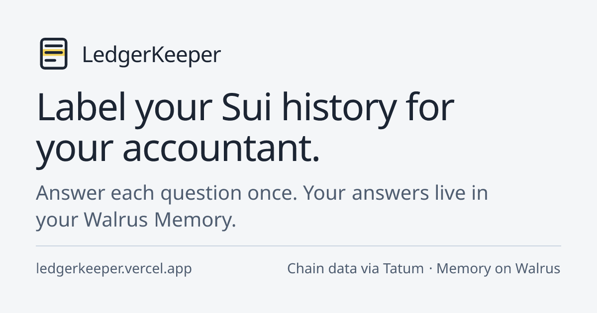
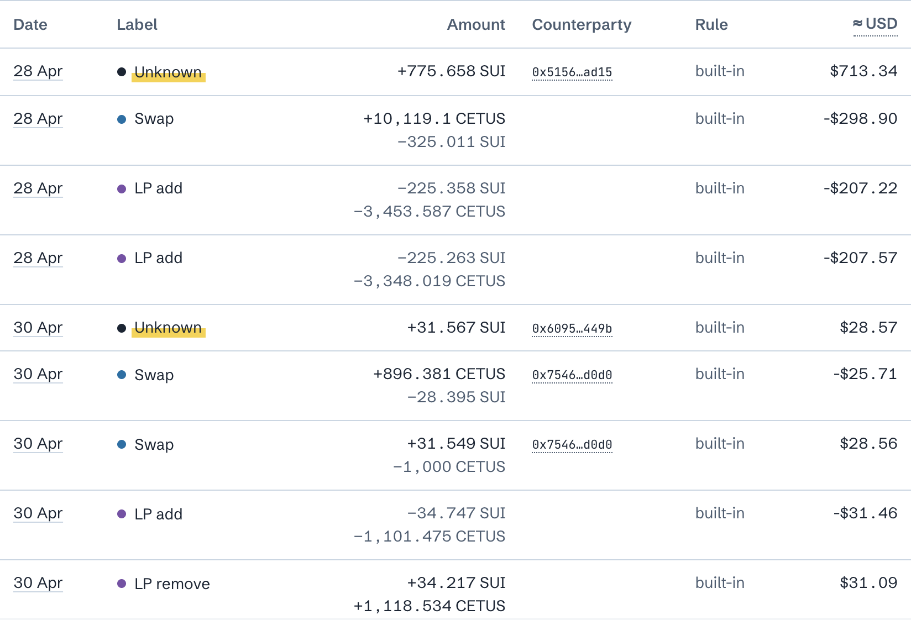
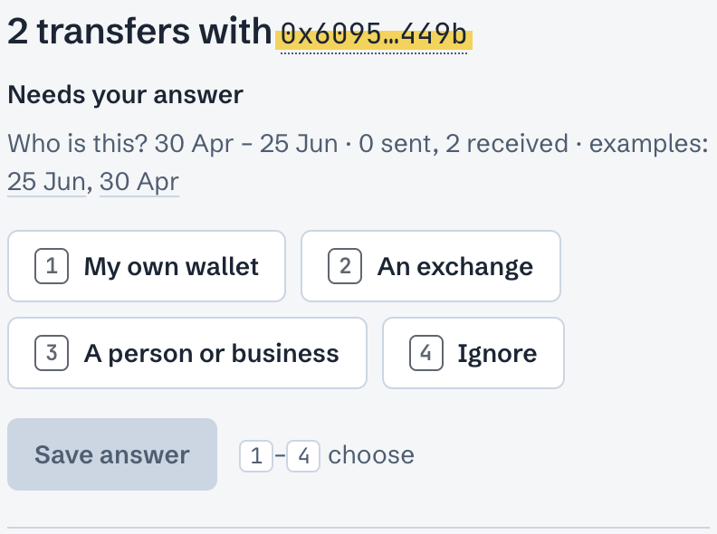
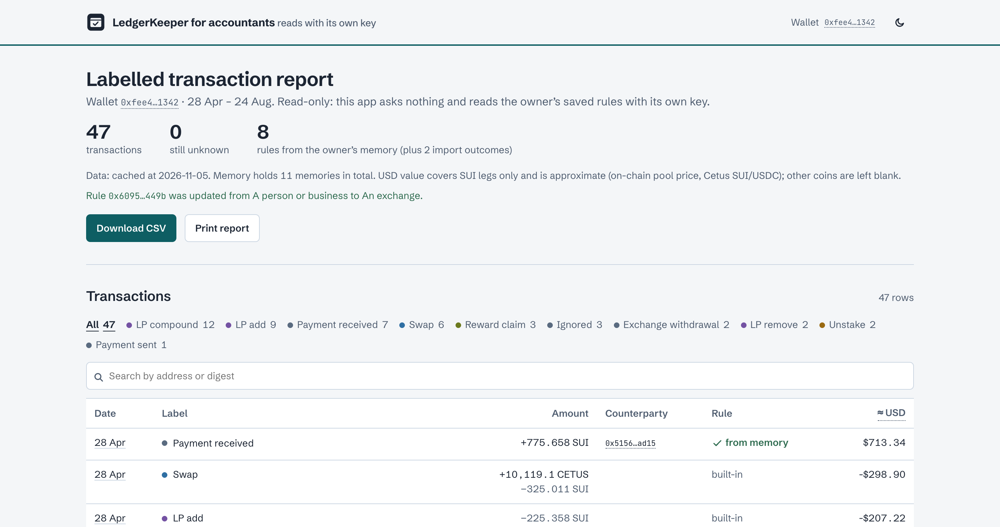

<!--
DRAFT. Not published. Plain markdown that pastes into Medium.
How to use: upload each image listed below in Medium by hand (paths are relative to this file). The cover image is docs/og-image.png.
Open items for the author: the "Real users" section (numbers come from `npx tsx scripts/usage.ts`), the two [LINK] placeholders, and the 22 Oct incident sentence (check the date and wording before it goes out).
-->

# LedgerKeeper: answer each Sui accounting question once

*It labels your Sui transactions for your accountant and remembers every answer in Walrus Memory.*



Every crypto tax tool I have seen asks the same question again and again: who is this address? You answer it, and next quarter, or in the next tool, you answer it again. I built LedgerKeeper for the Total Recall hackathon (Consumer Finance Apps track) so that an answer is given once and then kept where you own it.

LedgerKeeper reads a Sui wallet's history, labels what it can (transfers, swaps, liquidity, staking, rewards) and asks about the rest, one question per counterparty or contract. Each answer is stored as a short rule in Walrus Memory on mainnet. The next import starts from those rules, and so does a second app, the accountant view, which reads the same memory with its own key. This is a labelling tool, not tax advice.



## How Walrus Memory is wired

One memory per answer. These are real lines from the sample run (the wallet is the public sample wallet, `0xfee4…1342`):

```text
[tax-rule] match=0x60956e40…a449b kind=person v=2
[tax-rule] match=0x60956e40…a449b kind=exchange v=2
[import] wallet=0xfee4…1342 range=2026-07-01..2026-08-31 txs=11 asked=3 answered=3 reused=2 v=1
```

The first line is a rule: this counterparty is a person. The second is a correction made a few minutes later; the newest memory wins, and the label follows the transfer's direction. The third is an import outcome, which the next import reads back ("last time you answered 5 of 5").

The SDK surface is small:

- `remember(text, { idempotencyKey })` saves a rule. It returns a job id right away, and the memory is searchable only after the job finishes.
- `getRememberStatus(jobId)` is polled until the blob id appears.
- `recall({ query })` finds the rules, and `listMemories()` counts them, so a recall that returns fewer items than the namespace holds is flagged instead of trusted.

Chain data comes through Tatum's Sui GraphQL gateway: transactions by address with balance changes, events and Move calls. I also use it to read the Cetus SUI/USDC pool at past checkpoints to show approximate USD values for SUI legs. A balance query tells an empty wallet from one whose activity is older than Tatum's history, which starts on 23 January 2026.

## Before and after

The sample wallet has 47 transactions. The first import (up to 30 June, 36 transactions) labelled 28 and raised 5 questions. I answered all five. The second import (1 July to 31 August, 11 transactions) is the same wallet a few weeks later:

- With memory off it asks 5 questions, and 2 of them are ones I had already answered.
- With memory on it asks 3, and none is a repeat. The 2 answers came from memory and are filed into the drawer on screen.



The accountant view is a separate page that reads with a second delegate key. For the sample wallet its CSV is identical to the main app's: 47 rows, and `diff` finds nothing.



## Real users

> **[TO FILL FROM REAL NUMBERS. Do not publish this section as it stands.]**
>
> Run `npx tsx scripts/usage.ts --hours 72 --exclude-sessions <my test sessions>` and paste the output: sessions, memories stored, questions answered, distinct wallets imported. Say plainly that the wallet count is a floor (an import is recorded only once it has nothing left to answer) and that own-memory beta accounts are private and not counted.
>
> Add tester quotes only if the person agreed to be quoted, with their words unchanged.

## What broke

- **Writes are slow.** On mainnet a save took 15 to 23 seconds alone and up to about 33 seconds with several in flight, plus about 2 more until recall finds it. A request that waits for that does not fit a serverless time limit, so saving became `remember()` plus polling `getRememberStatus()`, with an idempotency key so a retry or a double click cannot store two memories. I shared the numbers on [walrus-memory#277](https://github.com/MystenLabs/walrus-memory/issues/277#issuecomment-6683013649).
- **A key that is not registered passes `health()`.** The first write then fails with a generic 401, and I had to read the account object on-chain to find the cause. Details on [walrus-memory#1125](https://github.com/MystenLabs/walrus-memory/issues/1125#issuecomment-6683014141).
- **Delegate keys cannot be scoped.** The accountant app was meant to be read-only. Its key wrote a memory in 23.5 seconds. So the accountant is trusted, not enforced: [#1384](https://github.com/MystenLabs/walrus-memory/issues/1384).
- **`listMemories()` returns no text,** so a completeness check can compare counts and blob ids but not content: [#1385](https://github.com/MystenLabs/walrus-memory/issues/1385).
- **A browser cannot call the relayer.** For "use my own memory" the relayer sends no CORS header for this site, so signed requests go through a thin same-origin pass-through that forwards them untouched and holds no keys.
- **My first questions were wrong.** I asked users to pick a label ("payment sent", "exchange deposit") for a counterparty, but one counterparty has transfers in both directions. Answers now say who the counterparty is, and the label follows direction.
- **Most wallets that trade on a DEX are bots.** Finding a human-looking wallet took several attempts.
- **When Walrus Memory is down, the app should not be.** After the relayer incident on 22 October [LINK: incident write-up, check the date], recall failures now fall back to the rules the app last read, say "Memory unavailable, using your rules as last read at 14:32", and switch saving off until memory answers again.

I tested the labelling by hand on small samples from three wallets, not on large ones, and the project has 43 automated tests. I did not use Tatum's AI Builder.

## What is next

A second key for the accountant view that works with an own-memory account, and read-only keys once delegate keys can be scoped. Today an accountant of an own-memory user gets the CSV from the main app.

## Try it

- Demo: https://ledgerkeeper.ajkadri.dev (the "Try the sample wallet" button takes about two minutes)
- Code (Apache-2.0): https://github.com/AjKadri/ledgerkeeper

LedgerKeeper is not affiliated with Ledger SAS.
